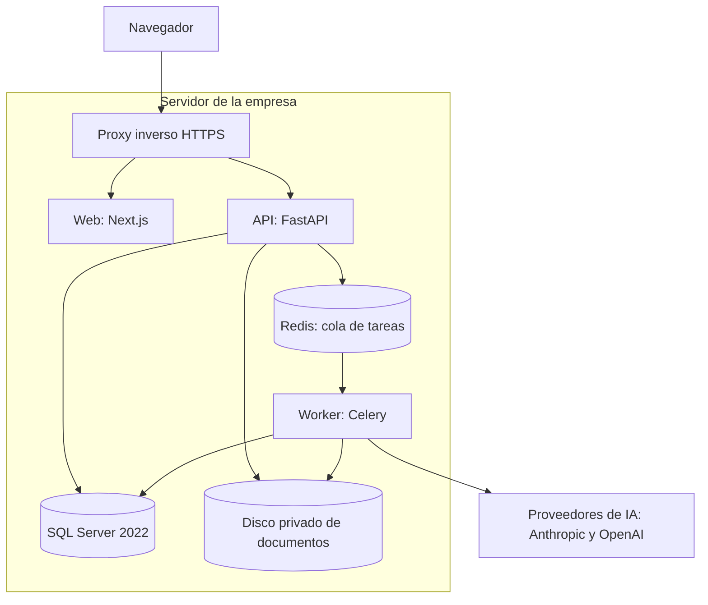

# Arquitectura general

> Origen: propuesta de arquitectura aprobada el 10 de noviembre de 2026.
> Este archivo es la copia de trabajo del repositorio y se actualiza en cada fase.

## Resumen

Se propone un monolito modular en FastAPI, con frontend Next.js, workers Celery y SQL Server 2022 como fuente de verdad. Los documentos se guardan en el sistema de archivos privado de tu servidor y SQL Server conserva sus metadatos. Este documento cubre los 25 puntos de la primera entrega (sección 38 del documento maestro). La aprobaste el 10 nov 2026 con dos cambios: usuarios sin correo electrónico y entrega del código en GitHub.

**Cómo aprobar.** La sección 25 lista 14 decisiones, cada una con una opción recomendada. Basta con que respondas "apruebo" e indiques las que quieras cambiar. Con eso empiezo la Fase 1.

| Dato | Estado |
| --- | --- |
| Motor de base de datos | SQL Server 2022, confirmado por ti el 10 nov 2026 |
| Despliegue | Lo hace Sistemas a partir del repositorio que tú subas a Git |
| Git | Autorizado el 10 nov 2026: el código se sube a github.com/josebgarcia99/sistemarh |
| Sistema operativo del servidor, Docker, rutas y certificados | Sin verificar; los define Sistemas (sección 1) |
| Volumen esperado de usuarios y CV | Sin dato; se diseñó con supuestos explícitos (sección 1) |

Lo que no se pudo verificar aparece como supuesto o como pendiente, nunca como hecho.

## 1. Diagnóstico del entorno

Solo hay un dato confirmado del entorno productivo: SQL Server 2022. Todo lo demás depende de Sistemas, así que la arquitectura se diseñó para no depender del sistema operativo anfitrión.

| Aspecto | Estado | Consecuencia para el diseño |
| --- | --- | --- |
| SQL Server | 2022, confirmado | Se usan `UNIQUEIDENTIFIER`, `DATETIME2`, `ROWVERSION`, funciones JSON y Row-Level Security. No se depende de funciones exclusivas de la edición Enterprise. Falta confirmar edición e intercalación. |
| Sistema operativo del servidor | Sin verificar | Celery no tiene soporte oficial en Windows. Si el servidor es Windows Server, los workers y Redis deben correr en contenedores Linux. |
| Docker en el servidor | Sin verificar | Se entrega Docker Compose como vía principal. Sin Docker habría que documentar la instalación como servicios del sistema, con más trabajo para Sistemas. |
| Instancia SQL Server para desarrollo y pruebas | No existe todavía | Mientras no haya una, los módulos se prueban con repositorios de prueba y cada integración sin validar queda marcada en `docs/estado_proyecto.md`. |
| Mi acceso al servidor | Ninguno, por diseño | No ejecuto scripts ni despliegues. Entrego el proyecto como carpeta lista para Visual Studio Code. |
| Git | Autorizado el 10 nov 2026 | Preparo `.gitignore` y la comprobación de secretos; tú haces el primer commit. |
| Proxy inverso, dominio y certificados HTTPS | Sin verificar | Se entrega configuración de ejemplo; Sistemas aporta dominio y certificado. |
| Ruta física de almacenamiento | Sin definir | Es configurable por variable de entorno; el ejemplo es `/srv/reclutamiento/storage/`. |
| OCR y conversión de archivos DOC | Sin verificar | Se proponen Tesseract y LibreOffice dentro del contenedor del worker (decisiones 6 y 7). |
| Claves de Anthropic y OpenAI | Las registras tú en la pantalla de configuración | Hasta entonces las pruebas usan un proveedor simulado y CV sintéticos. |

**Supuestos de volumen.** No hay cifras reales, así que se dimensionó para hasta 50 usuarios, lotes de hasta 500 CV y archivos de hasta 20 MB. Si tus números son mayores, cambia el número de workers, no la arquitectura (sección 24).

**Lo que Sistemas deberá informar antes del despliegue:** sistema operativo y versión, disponibilidad de Docker, edición e intercalación de SQL Server, ruta y capacidad del disco de documentos, destino de los respaldos, dominio y certificado.

## 2. Arquitectura técnica seleccionada

El sistema es un solo backend desplegable, organizado por dominios, que corre como tres procesos: web, API y worker. Todo vive en un monorepositorio.

| Capa | Tecnología | Papel |
| --- | --- | --- |
| Frontend | Next.js, React, TypeScript estricto, Tailwind CSS, shadcn/ui, React Hook Form, Zod, TanStack Query y Table, Recharts | Interfaz. No guarda secretos ni decide permisos. |
| API | Python 3.12, FastAPI, Pydantic, SQLAlchemy, pyodbc con ODBC Driver 18, Alembic | Reglas de negocio, autorización y contratos OpenAPI bajo `/api/v1/`. |
| Worker | Celery, PyMuPDF, python-docx, OCR local, pandas, openpyxl, zipfile, SDK oficiales de Anthropic y OpenAI | OCR, extracción, evaluación con IA, Excel, ZIP y reportes. |
| Cola | Redis | Solo intermediario de tareas. Si se pierde, los lotes se reconstruyen desde SQL Server. |
| Datos | SQL Server 2022 | Fuente de verdad de todo dato estructurado. |
| Documentos | Sistema de archivos privado del servidor, detrás de `FileStorageService` | Originales, reportes y exportaciones. |
| Infraestructura | Docker Compose, proxy inverso con HTTPS, volúmenes persistentes | Tres entornos separados: desarrollo, pruebas y producción. |

Las versiones exactas se fijan en archivos de bloqueo al iniciar la Fase 1, con la versión estable vigente ese día.

**Capas dentro de cada módulo.** Cada dominio tiene cuatro carpetas: `api` (rutas y esquemas), `application` (casos de uso), `domain` (entidades y reglas en Python puro) e `infrastructure` (repositorios y adaptadores). Las dependencias apuntan hacia el dominio, nunca al revés.

**Reglas entre módulos.**

- Un módulo usa a otro solo por su interfaz pública, nunca por sus tablas o repositorios.
- Las dependencias circulares se bloquean en la integración continua con una regla de importaciones.
- La autorización se resuelve en un solo lugar (`core/permissions`) y todos los módulos la consultan.
- Los reportes leen mediante vistas SQL del módulo `reporting`, sin tocar la lógica de otros módulos.
- Auditoría y actualización de indicadores reaccionan a eventos internos del proceso. No hay event sourcing ni CQRS.

## 4. Diagrama de componentes

Solo el proxy queda expuesto a la red. La API y el worker son los únicos que tocan SQL Server y el disco de documentos, y solo el worker llama a los proveedores de IA.

El navegador solo habla con el proxy. La API y el worker comparten SQL Server y el disco; Redis transporta únicamente identificadores de tareas.

## 7. Flujo de información

SQL Server guarda todo el estado. Redis transporta únicamente identificadores de tareas, nunca contenido de CV ni claves.

Ejemplo con un lote de CV:

1. El navegador entra por el proxy con HTTPS. Next.js sirve la interfaz y las llamadas de datos van a `/api/v1/` en el mismo dominio, con cookie de sesión `HttpOnly` y token CSRF.
2. La API autentica al usuario y comprueba su permiso sobre la vacante antes de aceptar cualquier archivo.
3. `FileStorageService` recibe el archivo en la zona temporal, valida tipo y tamaño, calcula el SHA-256, lo mueve a su ubicación definitiva y registra los metadatos en SQL Server.
4. La API crea el lote y sus tareas en SQL Server y publica en Redis un mensaje por CV con su identificador.
5. El worker toma cada tarea, confirma que el lote sigue vigente, lee el archivo, extrae texto o aplica OCR y llama al proveedor de IA con la clave que obtiene del almacén de secretos.
6. El worker valida el JSON de respuesta, calcula la puntuación en Python y guarda cada paso con su estado en SQL Server.
7. Al terminar el lote, el worker genera el Excel y los ZIP, los guarda en el disco y registra la exportación con su hash.
8. El frontend consulta el avance cada pocos segundos. El usuario puede cerrar el navegador y volver después.
9. Cada descarga pasa por la API, que vuelve a comprobar el permiso vigente, transmite el archivo y deja registro en auditoría.

Si falla el proveedor de IA, el CV queda en estado `FALLIDO` o en reintento. El original y los pasos anteriores permanecen guardados.

## 24. Riesgos técnicos y operativos

Los dos riesgos que pueden frenar el proyecto desde el inicio son de entorno, no de diseño: el sistema operativo del servidor y la falta de una instancia SQL Server de pruebas.

| Riesgo | Tipo | Mitigación |
| --- | --- | --- |
| El servidor es Windows y no admite contenedores Linux | Técnico | Confirmarlo con Sistemas antes de la Fase 1; Celery y Redis necesitan Linux. |
| No hay SQL Server de pruebas | Técnico | Instancia de desarrollo desde la Fase 1 (decisión 2); sin ella las integraciones se validan tarde. |
| Desajuste entre disco y base de datos | Técnico | Escritura recuperable, conciliación nocturna y manifiesto de respaldo. |
| OCR deficiente en escaneos pobres | Técnico | Umbral de confianza; el CV queda `NO_EVALUABLE` y pasa a revisión manual. |
| Respuestas de IA variables entre ejecuciones | Técnico | Versiones fijas, puntuación en Python, evidencia verificada y evaluaciones que no se sobrescriben. |
| Instrucciones ocultas en un CV | Técnico | Defensas de la sección 15 y prueba automatizada con un CV hostil. |
| Caída o límite de tasa del proveedor | Técnico | Reintentos, pausa del lote y reanudación; nada se pierde. |
| Disco de documentos lleno | Técnico | Métrica de espacio libre, alerta y rechazo ordenado de cargas. |
| Costo de IA fuera de control | Operativo | Límite mensual, tope por lote y estimación previa. |
| Fuga de documentos sensibles | Operativo | Permiso adicional, cifrado, finalidad registrada y auditoría. |
| Uso discriminatorio de la clasificación | Operativo | Sin atributos protegidos ni reglas ocultas; RH revisa todos los CV; revisión legal de rúbricas. |
| Confianza excesiva de RH en la IA | Operativo | La interfaz recuerda que no es decisión definitiva y se mide cuántas veces RH corrige a la IA. |
| Retención y aviso de privacidad sin definir | Operativo | Bloquea el uso de datos reales; lo define tu área legal. |
| Pérdida de la clave maestra | Operativo | Custodia y respaldo por Sistemas; sin ella habría que registrar las API keys de nuevo. |
| Alcance amplio | Operativo | Fases con criterio de cierre; ninguna empieza sin cerrar la anterior. |

**Cómo escala la arquitectura.** La API no guarda estado, el trabajo pesado pasa por una cola y los documentos están detrás de una interfaz. Por eso crecer significa añadir capacidad, no rediseñar.

| Si aumentan | Cambio necesario |
| --- | --- |
| Usuarios | Más procesos de la API detrás del proxy; las sesiones ya están en SQL Server. |
| Vacantes y postulaciones | La paginación y los índices ya están previstos; con decenas de millones de filas, particionar por fecha las tablas de historial y auditoría. |
| Documentos | Ampliar el disco o añadir un volumen; más allá, migrar a un almacén compatible con S3 con un adaptador nuevo. |
| Evaluaciones | Más workers, colas separadas para OCR, IA y exportaciones, o workers en otra máquina. El límite real pasa a ser el del proveedor de IA. |
| Consultas de reportes | Tablas de resumen o vistas indexadas; después, una réplica de lectura. |

No está previsto operar varias empresas en una misma instalación. Si lo necesitas, hay que decidirlo antes de la Fase 2 porque afecta a todas las tablas.
