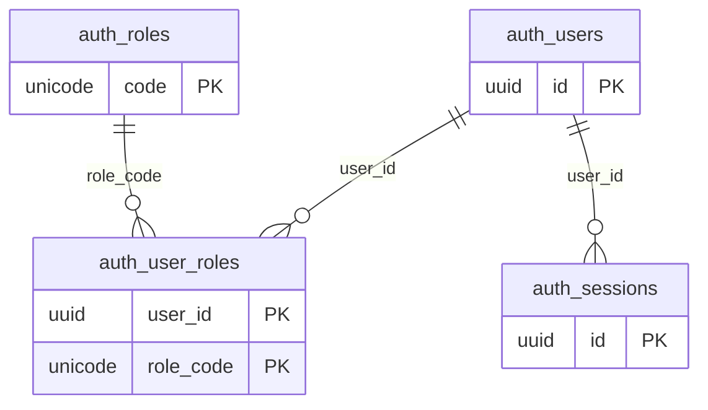
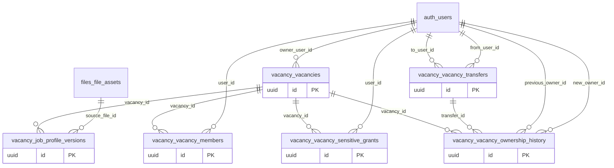
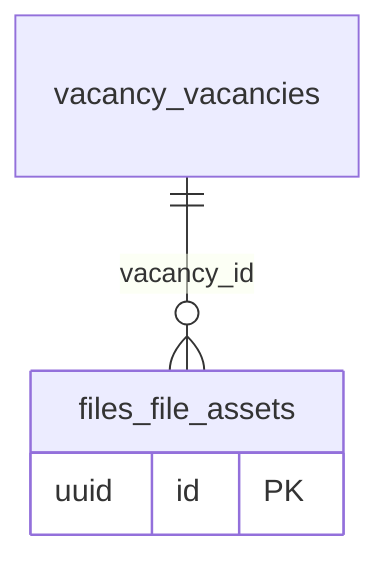
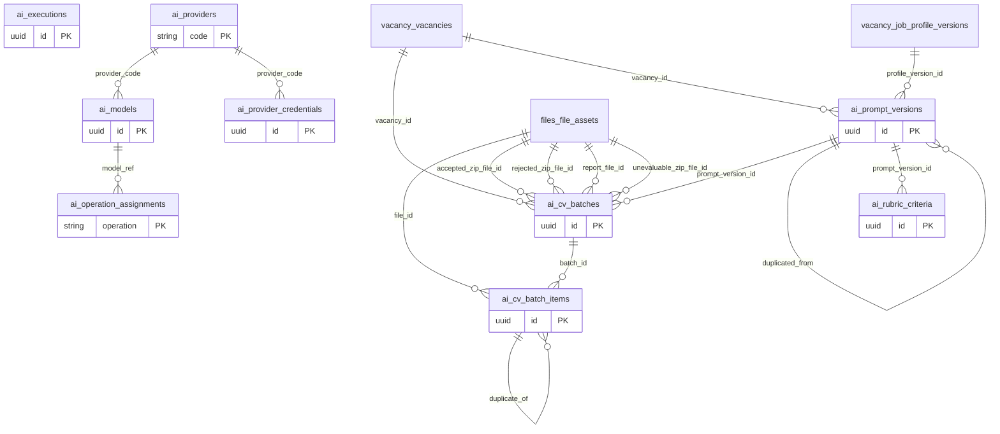
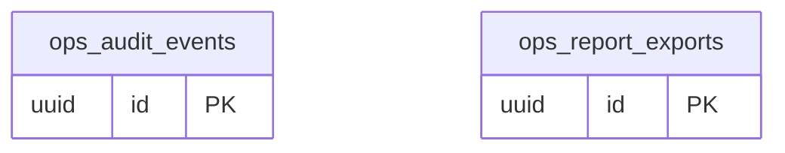

# Diagrama entidad-relación

> Generado por `scripts/generate_docs.py` a partir del modelo de datos. No editar a mano.

Versión del esquema: `0013`. Tablas: 36. El detalle de cada columna está en [`diccionario_datos.md`](diccionario_datos.md).

Cada diagrama muestra las tablas de un esquema y sus relaciones, también con tablas de otros esquemas. Para que se lean, se omiten las columnas de autoría (quién creó, modificó o aprobó algo), que apuntan todas a `auth.users`.

## Identidad (`auth`)

## Vacantes y acceso (`vacancy`)

## Documentos (`files`)

## Inteligencia artificial (`ai`)

## Reclutamiento (`recruitment`)

```mermaid
erDiagram
  recruitment_application_movements {
    uuid id PK
  }
  recruitment_application_outcomes {
    uuid id PK
  }
  recruitment_application_syntheses {
    uuid id PK
  }
  recruitment_applications {
    uuid id PK
  }
  recruitment_assessments {
    uuid id PK
  }
  recruitment_call_sessions {
    uuid id PK
  }
  recruitment_campaigns {
    uuid id PK
  }
  recruitment_candidates {
    uuid id PK
  }
  recruitment_form_template_versions {
    uuid id PK
  }
  recruitment_form_templates {
    uuid id PK
  }
  recruitment_pipeline_stages {
    uuid id PK
  }
  recruitment_pipeline_versions {
    uuid id PK
  }
  recruitment_question_bank_versions {
    uuid id PK
  }
  recruitment_question_banks {
    uuid id PK
  }
  recruitment_applications ||--o{ recruitment_application_movements : application_id
  recruitment_pipeline_stages ||--o{ recruitment_application_movements : from_stage_id
  recruitment_pipeline_stages ||--o{ recruitment_application_movements : to_stage_id
  recruitment_applications ||--o{ recruitment_application_outcomes : application_id
  vacancy_vacancies ||--o{ recruitment_application_outcomes : vacancy_id
  recruitment_applications ||--o{ recruitment_application_syntheses : application_id
  vacancy_vacancies ||--o{ recruitment_application_syntheses : vacancy_id
  recruitment_campaigns ||--o{ recruitment_applications : campaign_id
  recruitment_candidates ||--o{ recruitment_applications : candidate_id
  files_file_assets ||--o{ recruitment_applications : cv_file_id
  ai_cv_batch_items ||--o{ recruitment_applications : evaluation_item_id
  recruitment_pipeline_stages ||--o{ recruitment_applications : stage_id
  vacancy_vacancies ||--o{ recruitment_applications : vacancy_id
  recruitment_applications ||--o{ recruitment_assessments : application_id
  files_file_assets ||--o{ recruitment_assessments : file_id
  recruitment_form_template_versions ||--o{ recruitment_assessments : template_version_id
  vacancy_vacancies ||--o{ recruitment_assessments : vacancy_id
  recruitment_applications ||--o{ recruitment_call_sessions : application_id
  recruitment_question_bank_versions ||--o{ recruitment_call_sessions : bank_version_id
  vacancy_vacancies ||--o{ recruitment_call_sessions : vacancy_id
  recruitment_pipeline_versions ||--o{ recruitment_campaigns : pipeline_version_id
  vacancy_vacancies ||--o{ recruitment_campaigns : vacancy_id
  recruitment_form_templates ||--o{ recruitment_form_template_versions : template_id
  recruitment_pipeline_versions ||--o{ recruitment_pipeline_stages : pipeline_version_id
  recruitment_question_banks ||--o{ recruitment_question_bank_versions : bank_id
  recruitment_question_banks ||--o{ recruitment_question_banks : duplicated_from
  auth_users ||--o{ recruitment_question_banks : owner_user_id
```

## Operación (`ops`)

