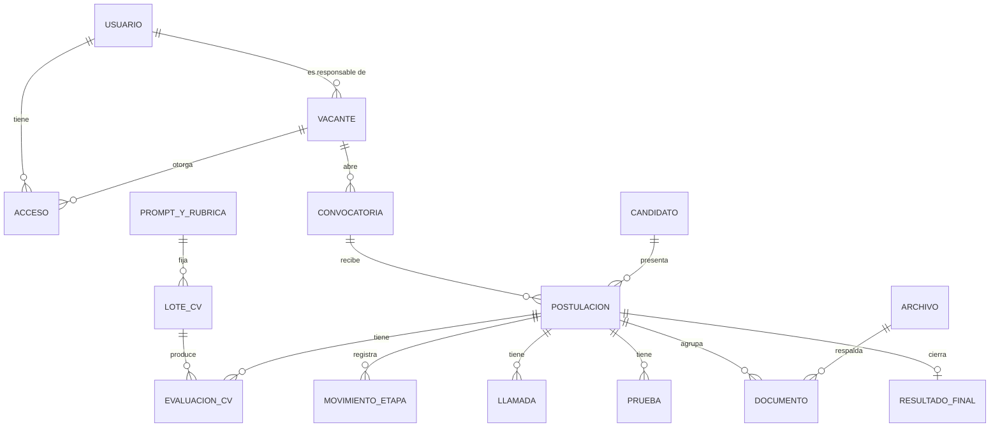

# Modelo relacional

> Origen: propuesta de arquitectura aprobada el 10 de noviembre de 2026.
> Este archivo es la copia de trabajo del repositorio y se actualiza en cada fase.

## 13. Modelo relacional SQL Server 2022

El modelo tiene 70 tablas en 10 dominios. Parte de tu lista, elimina una tabla redundante, renombra una y añade 10 que hacían falta para cumplir reglas del propio documento maestro. Los scripts T-SQL definitivos se generan cuando los pidas.

**Convenciones**

- Clave primaria `UNIQUEIDENTIFIER` con un identificador secuencial generado por la aplicación (`app/core/ids.py`), para limitar la fragmentación y conocer el identificador antes de insertar.
- Fechas en `DATETIME2(3)` y en UTC; la interfaz las muestra en America/Mexico\_City.
- Texto en `NVARCHAR`; puntuaciones en `DECIMAL(5,2)`; costos en `DECIMAL(12,6)`.
- `ROWVERSION` en las tablas editables, para control de concurrencia optimista.
- Estados como texto con restricción `CHECK`.
- Columnas de autoría (`created_at`, `created_by`) en todas las tablas; nunca se actualizan.
- JSON en `NVARCHAR(MAX)` validado con `ISJSON`, solo para estructuras semiestructuradas. Lo que se busca o se relaciona va en columnas.
- Un esquema SQL por dominio, para que Sistemas pueda revisar y asignar permisos por área.
- Nada se borra en cascada. Los registros se desactivan o archivan.

**Tablas por dominio**

| Dominio | Tablas | Cambios frente a tu propuesta |
| --- | --- | --- |
| Identidad | `users`, `roles`, `user_roles`, `sessions`, `user_tokens` | Se añade `user_tokens` en la propuesta original; ya no se creará porque no habrá invitaciones ni recuperación por correo. El modelo queda en 69 tablas. |
| Vacantes y acceso | `vacancies`, `vacancy_members`, `vacancy_sensitive_grants`, `vacancy_ownership_history`, `vacancy_transfers`, `vacancy_transfer_items`, `job_profile_versions`, `recruitment_campaigns` | Se añade `vacancy_sensitive_grants` para el permiso adicional de documentos sensibles. |
| Candidatos | `candidates`, `applications`, `application_documents` | Se elimina `candidate_documents`: todo documento entra por una postulación. |
| IA | `ai_providers`, `ai_provider_credentials`, `ai_models`, `ai_operation_assignments`, `ai_budgets`, `ai_executions`, `prompt_versions`, `prompt_version_layers`, `rubric_versions`, `rubric_criteria`, `cv_batches`, `cv_batch_items`, `cv_extractions`, `cv_evaluations`, `cv_criterion_scores`, `evaluation_evidence` | `ai_model_configurations` pasa a llamarse `ai_models` (el registro). Se añaden las credenciales cifradas, la asignación por operación, los presupuestos, las capas del prompt y `cv_batch_items`, con el estado de cada paso por CV. |
| Etapas | `workflow_templates`, `workflow_versions`, `workflow_stages`, `application_stage_history`, `stage_tasks` | Sin cambios. |
| Bancos y llamadas | `question_banks`, `question_bank_versions`, `question_bank_shares`, `questions`, `question_rubrics`, `phone_sessions`, `phone_answers`, `phone_analyses` | Se añade `question_bank_shares` para el alcance compartido. |
| Pruebas | `psychometric_instruments`, `psychometric_applications`, `psychometric_results`, `manager_interviews`, `manager_feedback`, `technical_assessments`, `technical_results` | Sin cambios. |
| Estudios | `study_templates`, `study_template_versions`, `study_fields`, `study_submissions`, `study_answers`, `study_verifications` | Sin cambios. |
| Cierre | `application_outcomes`, `hires` | Sin cambios. |
| Documentos y operación | `file_assets`, `file_versions`, `export_jobs`, `export_files`, `processing_incidents`, `audit_events`, `privacy_requests`, `retention_policies`, `idempotency_keys`, `app_settings` | Se añaden las claves de idempotencia de la API y los parámetros del sistema. |

**Cardinalidades principales**

- Una vacante tiene muchas convocatorias; una convocatoria tiene muchas postulaciones; un candidato tiene muchas postulaciones.
- Una postulación tiene muchas evaluaciones de CV, llamadas, pruebas, entrevistas, estudios, documentos y movimientos de etapa, y como máximo una contratación.
- Un lote usa exactamente una versión de prompt y una de rúbrica. Una evaluación tiene una puntuación por criterio y cada puntuación tiene sus evidencias.
- Una sesión telefónica apunta a la versión del banco que se usó, no al banco.
- Un archivo tiene muchas versiones y puede estar referido por documentos de postulación, resultados o exportaciones.

**Reglas que la base de datos hace cumplir**

| Regla | Mecanismo |
| --- | --- |
| Toda vacante tiene responsable | `vacancies.owner_user_id` obligatorio con clave foránea. |
| Un solo acceso por usuario y vacante | `UNIQUE (vacancy_id, user_id)` en `vacancy_members`. |
| Una postulación por candidato y convocatoria | `UNIQUE (candidate_id, campaign_id)`. |
| Solo prompts aprobados evalúan CV | Validación en el caso de uso y disparador en `cv_batches`. |
| Versiones aprobadas inmutables | Disparador que rechaza cambios, salvo el paso a `ARCHIVADO`. |
| Las evaluaciones no se sobrescriben | `cv_evaluations` solo admite inserciones; un reanálisis crea otra fila y un índice único filtrado marca la vigente. |
| Una contratación no se cuenta dos veces | `UNIQUE (application_id)` en `hires`; los tableros cuentan contrataciones, no colaboradores. |
| Auditoría inalterable | El usuario de la aplicación no tiene permiso de `UPDATE` ni `DELETE` sobre `audit_events` (decisión 12). |
| Control de concurrencia | `ROWVERSION` comparado en cada actualización; si cambió, la API responde conflicto. |

**Índices y vistas.** Se crean índices compuestos solo para los filtros de las pantallas: postulaciones por convocatoria y etapa, movimientos por postulación y fecha, evaluaciones por lote y clasificación, auditoría por fecha y actor, archivos por hash. Los tableros leen vistas (`vw_funnel`, `vw_time_in_stage`, `vw_ai_usage`, `vw_hires`).

**Migraciones.** Alembic con el dialecto de SQL Server. Cada cambio de esquema es una migración con su reversión documentada, y ninguna migración destructiva corre de forma automática. La carpeta `database/sqlserver/` recibirá el paquete T-SQL revisable por Sistemas.

## 14. Diagrama entidad-relación

La postulación es el centro del modelo: une a la persona con la convocatoria y de ella cuelga todo el expediente. El diagrama muestra las entidades principales; el diagrama completo a nivel de columna y el diccionario de datos se entregan con los scripts.

Una transferencia de vacante cambia al responsable y los accesos, sin tocar postulaciones ni archivos.
